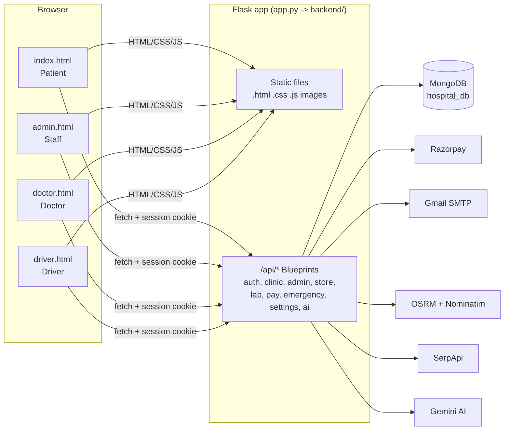
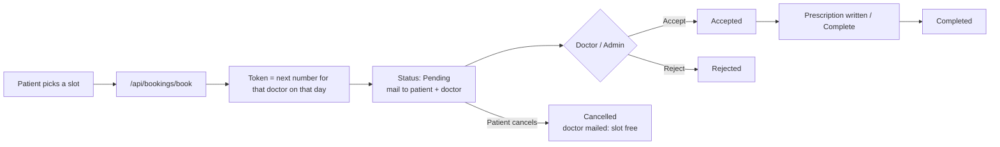
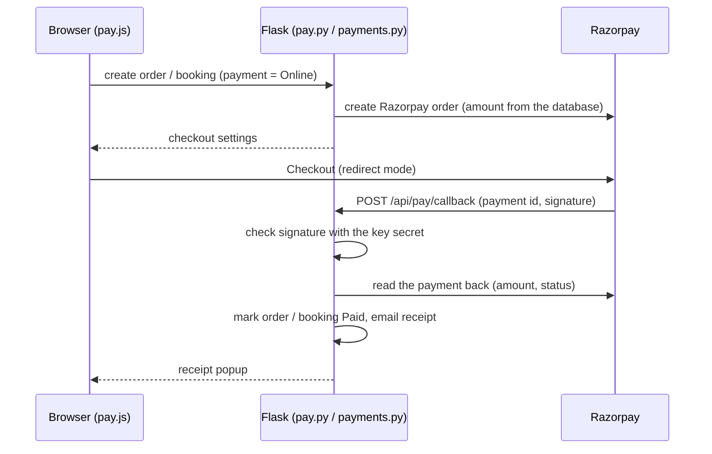

# SmartHealth Hospital — Project Documentation

> This document explains the whole project from start to end: what it does, what each file is for,
> the sections of every page, every API endpoint, the database collections, the payment / ambulance /
> lab flows, setup and hosting.
>
> Last updated: 24 Oct 2026 (based on commit `c73d3e3`)

---

## Contents

1. [What the project is](#1-what-the-project-is)
2. [Tech stack](#2-tech-stack)
3. [Project structure](#3-project-structure)
4. [Architecture](#4-architecture)
5. [Setup and running](#5-setup-and-running)
6. [Settings (.env variables)](#6-settings-env-variables)
7. [Users and access](#7-users-and-access)
8. [Patient website (index.html)](#8-patient-website-indexhtml)
9. [Admin panel (admin.html)](#9-admin-panel-adminhtml)
10. [Doctor portal (doctor.html)](#10-doctor-portal-doctorhtml)
11. [Ambulance driver page (driver.html)](#11-ambulance-driver-page-driverhtml)
12. [Receipt page (receipt.html)](#12-receipt-page-receipthtml)
13. [Feature flows](#13-feature-flows)
14. [API reference](#14-api-reference)
15. [Database (MongoDB)](#15-database-mongodb)
16. [Security](#16-security)
17. [Scripts](#17-scripts)
18. [Hosting](#18-hosting)
19. [Frontend conventions](#19-frontend-conventions)
20. [Known issues](#20-known-issues)
21. [Troubleshooting](#21-troubleshooting)

---

## 1. What the project is

**SmartHealth Hospital** is the complete online system of a hospital in Mumbai (Cross Road B, MIDC,
Andheri East – 400096). It has four portals:

| Portal | Page | Used by |
| --- | --- | --- |
| Patient website | `index.html` | Patients — doctor appointments, lab tests, medicine store, ambulance, SOS, health card, AI symptom check |
| Admin panel | `admin.html` | Hospital staff, limited by role (Super Admin, Receptionist, Lab Technician, Pharmacist, Emergency Desk) |
| Doctor portal | `doctor.html` | Doctors — their queue, patient history, QR scan, prescriptions |
| Driver page | `driver.html?t=<token>` | Ambulance drivers — live GPS sharing, current job, Arrived / Done |

`receipt.html` shows a payment receipt that can be printed or saved as PDF.

The project was first written in **PHP + MySQL** and now runs on **Python (Flask) + MongoDB**. Old
data is moved with `scripts/migrate_mysql_to_mongo.py`, and the old PHP password hashes (`$2y$`)
still work, so existing logins keep working.

---

## 2. Tech stack

| Layer | Technology |
| --- | --- |
| Backend | Python 3.12, Flask 3.1 (Blueprints) |
| Database | MongoDB (pymongo 4.17) — local, inside the Docker container, or MongoDB Atlas |
| Passwords | bcrypt |
| Web server | `waitress` on Windows (16 threads), `gunicorn` on Linux / Docker |
| Frontend | Plain HTML + CSS + JavaScript (no framework, no build step) |
| Icons / fonts | Font Awesome 6.5, Google Fonts (Inter, IBM Plex) |
| Maps | Leaflet 1.9.4 + OpenStreetMap tiles |
| Road routes | OSRM (`router.project-osrm.org`) |
| Address search | Nominatim (OpenStreetMap) |
| Nearby hospitals | SerpApi (Google Maps results) |
| Admin charts | Chart.js 4.4 |
| QR codes | `qrcodejs` (makes the card), `html5-qrcode` (doctor scans it) |
| Sign-in | Email + password, and Google Sign-In (`accounts.google.com/gsi`) |
| Payments | Razorpay (UPI, cards, net banking, wallets) + direct UPI QR |
| Email | Gmail SMTP (App password) |
| AI | Google Gemini `gemini-2.5-flash` |
| Voice guidance | The browser's `speechSynthesis` (Hindi / English) |

---

## 3. Project structure

```
hospital/
├── app.py                     # Entry point: calls create_app(), runs waitress or the dev server
├── requirements.txt           # Python packages
├── Dockerfile                 # Python 3.12 + MongoDB 8.0 in one container
├── docker-start.sh            # Starts MongoDB in the container (for a local URI), then gunicorn
├── .env.example               # Template for all settings (the real .env is never committed)
├── README.md                  # Short guide
├── DOCUMENTATION.md           # This file
│
├── backend/                   # ---- All server code ----
│   ├── __init__.py            # Builds the Flask app: blueprints, static files, error handlers, /api/health, /img/<id>
│   ├── config.py              # Reads settings from .env (MongoDB, mail, Razorpay, hospital location ...)
│   ├── db.py                  # MongoDB connection, numeric id counters, documents -> JSON, indexes
│   ├── utils.py               # Shared helpers: form values, ok()/fail(), login guards, IST time, image storage, rate limits
│   ├── permissions.py         # Admin sections, default roles, which section each admin action needs
│   ├── mail.py                # Gmail SMTP, notification log, retrying failed mails, appointment mails
│   ├── orders.py              # Medicine order steps, cancelling, expiring unpaid orders, delivery OTP, order mails
│   ├── payments.py            # Razorpay: create order, check signature, sync, refund, receipt (also as HTML mail)
│   ├── routing.py             # Road routes (OSRM), address search (Nominatim), ambulance position / ETA, nearby hospitals (SerpApi)
│   ├── lab_catalog.py         # 18 standard lab tests + 4 packages, reference ranges, High/Low flags, formula calculator
│   ├── med_art.py             # Draws an SVG "pack picture" for medicines without a photo
│   └── routes/                # ---- API endpoints (Flask Blueprints) ----
│       ├── auth.py            # Patient login / register / Google / logout / profile, staff login / register
│       ├── clinic.py          # Doctors, appointments, health card, prescriptions, doctor portal API, reminders
│       ├── admin.py           # Analytics, CSV export, medicine stock, medicine orders, notifications
│       ├── store.py           # Patient medicine store: products, ordering, UPI UTR, my orders, cancel
│       ├── lab.py             # Lab: patient booking + admin flow (collection, results, report), test catalogue
│       ├── pay.py             # Razorpay start / verify / failed / callback, receipt data
│       ├── emergency.py       # Ambulance booking, dispatch, tracking, SOS, driver API, fleet, address search
│       ├── settings.py        # Admin > Settings: roles and staff users
│       └── ai.py              # AI Symptom Checker (Gemini)
│
├── scripts/                   # ---- One-off / scheduled scripts ----
│   ├── migrate_mysql_to_mongo.py   # Old MySQL dump (hospital_db.sql) -> MongoDB
│   ├── copy_database.py            # Copies one MongoDB to another (local -> Atlas)
│   ├── add_medicines.py            # Adds common OTC medicines to the pharmacy
│   └── send_reminders.py           # Appointment reminder mails + failed mail retry (run hourly)
│
├── index.html                 # Patient website (one page with several "views")
├── admin.html                 # Admin panel
├── doctor.html                # Doctor portal (its CSS and JS are inside the file)
├── driver.html                # Ambulance driver page
├── receipt.html               # Payment receipt
│
├── popups.js / popups.css     # Shared in-app toast / confirm / prompt (instead of browser alerts) — used by every page
├── dashboard.js / .css        # Patient Dashboard (home view)
├── appointments.js / .css     # My Appointments
├── profile.js / .css          # My Profile
├── blog.js / .css             # Health Blog
├── features.js / .css         # Emergency SOS + Smart Health Card
├── sos-guide.js               # SOS > route to a nearby hospital with spoken directions
├── ambulance.js / .css        # Book Ambulance + live tracking
├── store.js / .css            # Medicine Store, cart, checkout, my orders
├── lab.js / .css              # Lab Tests booking, my bookings, reports
├── lab-report.js              # Lab report layout (shared by the patient site and the admin panel)
├── pay.js / .css              # Opens Razorpay Checkout + receipt popup (store and lab)
├── search.js                  # Header search (doctors, specialities, medicines, pages)
├── admin.js / admin.css       # Admin core: sign-in, menu, Appointments, Patients, Doctors, Ambulance
├── admin-features.js / .css   # Admin: Analytics, SOS & Fleet, Medicine Stock, Orders, Notifications
├── admin-lab.js               # Admin: Lab Bookings + Test Catalogue
├── admin-settings.js          # Admin: Settings (Roles + Staff users)
│
├── assets/                    # Logo, favicon
└── uploads/                   # Old uploaded photos (new photos are stored in the database)
```

The old PHP files and the MySQL export (`hospital_db.sql`) have been removed from the project folder.

---

## 4. Architecture



**How a request is handled:**

1. The browser calls `fetch('api/...')`. The user is identified by the **Flask session cookie**
   (HttpOnly, SameSite=Lax, Secure on HTTPS).
2. `before_request` — if the database was not set up at start-up, `try_setup()` tries again (at most
   once every 30 seconds), so the site heals itself once `MONGO_URI` is fixed.
3. The route checks access with `require_user()`, `require_doctor()` or `require_perm("section")`.
4. The reply is always `{"status": "success", ...}` or `{"status": "error", "message": "..."}`
   (a few older endpoints, such as `/api/bookings/status`, reply with plain text).
5. Slow work such as sending mail runs in a `background()` thread pool (4 workers), so the page does
   not wait for it.

**What is created at start-up** (`setup_database()` in `backend/__init__.py`):

| Step | What it does |
| --- | --- |
| `ensure_indexes` | All unique and search indexes; `geo_cache` entries expire after 7 days |
| `ensure_roles` | Super Admin + 4 default roles |
| `ensure_default_admin` | Super Admin for `ADMIN_EMAIL` (when that email has no staff login) |
| `seed_tests` | Standard lab tests missing from the catalogue (a deleted standard test is not added back) |
| `ensure_fleet` | Two ambulances at the hospital when the fleet is empty |

**IDs:** every collection uses a small integer `_id` (1, 2, 3 …) taken atomically from the
`counters` collection (`next_id()`), like the old MySQL tables. The browser receives it as `id`.
Dates are stored in UTC and sent to the browser as **Indian Standard Time** text.

---

## 5. Setup and running

### Local (Windows)

1. MongoDB must be running at `mongodb://localhost:27017/`.
2. Install the packages:

   ```bash
   py -3.12 -m pip install -r requirements.txt
   ```

3. Copy `.env.example` to `.env` and fill in the values (see the table below).
4. Start the site:

   ```bash
   py -3.12 app.py
   ```

5. Open:
   * Patient site: http://127.0.0.1:5000
   * Admin panel: http://127.0.0.1:5000/admin.html
   * Doctor portal: http://127.0.0.1:5000/doctor.html
   * Database check: http://127.0.0.1:5000/api/health

Set `FLASK_DEBUG=1` for the Flask debug server with auto-reload, and `PORT` to change the port.

### Starting data (optional)

```bash
py -3.12 scripts/add_medicines.py
```

```bash
py -3.12 scripts/migrate_mysql_to_mongo.py
```

---

## 6. Settings (.env variables)

All settings are read in `backend/config.py`. An empty value means the default is used.

| Variable | Default | Purpose |
| --- | --- | --- |
| `MONGO_URI` | `mongodb://127.0.0.1:27017` | Database link (`mongodb+srv://...` for Atlas) |
| `MONGO_DB` | `hospital_db` | Database name |
| `SECRET_KEY` | generated and kept in `.flask_secret` | Key that signs the session cookie |
| `ADMIN_EMAIL` / `ADMIN_PASSWORD` / `ADMIN_NAME` | default written in the code | First Super Admin (only created when that email has no staff login) |
| `MAIL_GMAIL_ADDRESS` / `MAIL_GMAIL_APP_PASSWORD` | empty | Gmail SMTP. Empty = mails are only written to the log |
| `MAIL_FROM_NAME` | SmartHealth Hospital | Sender name |
| `GOOGLE_CLIENT_ID` | empty | Google Sign-In (must match the id in `index.html`) |
| `HOSPITAL_NAME`, `HOSPITAL_PHONE`, `HOSPITAL_ADDRESS` | SmartHealth, +91 75070 41642, Andheri East | Used in mails, receipts and the SOS call button |
| `HOSPITAL_LAT` / `HOSPITAL_LNG` | 19.11499 / 72.86817 | Hospital location — every ambulance route starts here |
| `SERVICE_RADIUS_KM` | 40 | Requests further away are flagged as outside the service area |
| `ROUTE_TRAFFIC_FACTOR` | 1.35 | OSRM free-flow time is multiplied by this for Mumbai traffic |
| `OSRM_URL` / `NOMINATIM_URL` | public servers | Use your own servers for heavy traffic |
| `REMINDER_HOURS_BEFORE` | 24 | How many hours before an appointment the reminder is sent |
| `UPI_ID` / `UPI_PAYEE_NAME` / `UPI_PAY_MINUTES` | empty / hospital name / 30 | Direct UPI QR payment. Empty `UPI_ID` = off |
| `RAZORPAY_KEY_ID` / `RAZORPAY_KEY_SECRET` | empty | Online payment. `rzp_test_` keys = test mode. Empty = off |
| `RAZORPAY_THEME` | `#2563eb` | Checkout colour |
| `SERPAPI_KEY` | empty | Nearby hospitals on the SOS screen. Empty = hidden |
| `GEMINI_API_KEY` | empty | AI Symptom Checker. Empty = off |
| `LAB_HOME_COLLECTION_FEE` / `LAB_FREE_COLLECTION_ABOVE` | 100 / 999 | Home sample collection fee, and the order value above which it is free |
| `PORT`, `FLASK_DEBUG`, `WEB_WORKERS` | 5000, –, 1 | Server settings |

Values fixed in the code: home delivery fee ₹40 (free from ₹500), at most 20 of one medicine per
order, delivery OTP valid for 24 hours with 5 tries, lab bookings up to 14 days ahead.

---

## 7. Users and access

| User | How they sign in | Session key | Guard |
| --- | --- | --- | --- |
| Patient | Email + password or Google, on `index.html` | `user_email` | `require_user()` |
| Staff | Email + password on `admin.html` | `admin_id` (role read from the database on every request) | `require_admin()`, `require_perm(section)` |
| Doctor | Email + password set by the admin, on `doctor.html` | `doctor_id` | `require_doctor()` |
| Driver | No login — private link `driver.html?t=<driver_token>` | — | token check |
| SOS caller | No login needed | `sos_token` | alert token |

### Staff roles (Admin > Settings)

There are 12 sections (`backend/permissions.py`):

| Section key | Name | Admin tab |
| --- | --- | --- |
| `appointments` | Appointments | booking-tab |
| `patients` | Patients | registered-users-tab |
| `doctors` | Doctors | doctor-list-tab, doctor-tab |
| `ambulance` | Ambulance Bookings | ambulance-bookings-tab |
| `sos` | SOS Alerts & Fleet | sos-tab |
| `lab` | Lab Bookings | lab-tab |
| `lab_catalogue` | Lab Test Catalogue | lab-tests-tab |
| `medicines` | Medicine Stock | medicine-tab |
| `orders` | Medicine Orders | orders-tab |
| `analytics` | Analytics & Reports | analytics-tab |
| `notifications` | Notifications | notifications-tab |
| `settings` | Settings: Roles & Users | settings-tab |

Default roles: **Super Admin** (everything), **Receptionist** (appointments, patients, doctors),
**Lab Technician** (lab), **Pharmacist** (medicines, orders), **Emergency Desk** (ambulance, sos).

Rules:
* The server checks the role on **every request**, so a hidden section cannot be opened by URL either.
* Switching an account off removes its access immediately.
* Super Admin always has every section and cannot be deleted; there is always at least one active Super Admin.
* Nobody can switch off, delete or demote their own account.

---

## 8. Patient website (`index.html`)

One page with several **views**. The left sidebar calls `switchView('name')` to change the view.
The header has a search bar (`search.js`), the current page name and the user info.

### 8.0 Sign in / Register (`authModal`, `setPassModal`)
* Email + password login and registration (`/api/auth/login`, `/api/auth/register`).
* **Google Sign-In** — the Google ID token is verified with Google on the server (`/api/auth/google`).
* A Google user can later set a password once (`setPassModal` → `/api/auth/set-password`).
* A sign-in notification mail is sent after every login.

### 8.1 Dashboard — `home-view` (`dashboard.js`)
| Section | Shows |
| --- | --- |
| Hero (`dashHero`) | Greeting for the time of day, today's date, **next appointment** card |
| KPI tiles (`dashKpis`) | Upcoming appointments, past visits, number of doctors, departments |
| Quick Actions | Shortcuts: book a doctor, this week's appointments, cart, etc. |
| Hospital Services (`svcShowcase`) | Auto-sliding cards: AI Symptom Check, Lab Tests, Ambulance, Medicine Store |
| Find a Doctor (`dash-doctors`) | Department filter, "available today", sorting, a free-text "ask" box, doctor cards, quick slot booking |

Clicking a doctor opens the **booking modal** (`bookingModal`): choose date and time slot →
`confirmBooking()` → `/api/bookings/book` → the patient gets a **token number**.

### 8.2 My Appointments — `bookings-view` (`appointments.js`)
* Two tabs: **Doctor appointments** and **Ambulance requests**.
* Shows the status (Pending / Accepted / Completed / Rejected / Cancelled).
* The patient can cancel a Pending or Accepted appointment.
* **Track live** for an ambulance request.

### 8.3 AI Symptom Check — `ai-checker-view`
* The patient describes symptoms → `/api/ai?action=symptoms` → answer from Gemini.
* The answer has four parts: Preliminary Assessment, Home Care, Recommended Specialist, Lab Tests That May Help.
* The server keeps only safe formatting tags (no scripts). One request per patient every 5 seconds.

### 8.4 Medicine Store — `store-view` (`store.js`)
* Product list (category, search, photo or drawn pack picture, stock).
* Cart → checkout form: name, phone, **Home Delivery** or **Pickup**, address, PIN code.
* Payment: **Online (Razorpay)**, **UPI QR** (patient enters the UTR), **Cash on Delivery / Pay at Pickup**.
* **My Orders**: status steps, cancel (while allowed), receipt link; the delivery OTP arrives by email.

### 8.5 My Health Card — `healthcard-view` (`features.js`)
* Digital card: name, blood group, allergies, past illnesses, emergency contact.
* A **QR code** (`SHQR:<token>`) on the card — a doctor scans it to open the full record.
* Medical details are edited here (`saveMedical`).
* **Regenerate** creates a new QR; old printed cards stop working.
* Also lists the patient's prescriptions.

### 8.6 Lab Tests — `lab-view` (`lab.js`, `lab-report.js`)
* Catalogue: Health Packages + categories (Haematology, Diabetes, Heart, Liver, Kidney, Thyroid,
  Imaging & ECG, Urine …) with price, sample type, fasting and report time.
* Booking: patient name, age, **gender** (reference ranges depend on it), phone, **Home Collection**
  or **Lab Visit**, date (up to 14 days ahead), time slot, payment (online or at collection).
* Fasting / preparation advice is generated automatically.
* **My Bookings** and the **report** (values flagged High/Low, printable / save as PDF).

### 8.7 Book Ambulance — `ambulance-view` (`ambulance.js`)
* **SOS** section at the top (`am-sos`).
* Pickup point by **GPS**, **address search**, or **tapping / dragging the pin** on the map.
* Road route from the hospital to the pickup point with distance and time.
* After booking, **live tracking** — the ambulance moves along the route on the map.

### 8.8 Emergency SOS (`features.js`, `sos-guide.js`)
* Pressing SOS sends the phone's location to the hospital (no login needed).
* A button to call the hospital (7507041642).
* After dispatch, the ambulance's live position.
* **Real nearby hospitals** (Google Maps via SerpApi) with distance, rating, open hours, call and directions.
* **Route** → road route from the caller to that hospital with **spoken turn-by-turn directions in
  Hindi or English**. It follows the phone's GPS, re-routes when the caller leaves the route and
  announces arrival.

### 8.9 My Profile — `profile-view` (`profile.js`)
* Name, phone, age, address, blood group (chips). The summary card updates while typing.
* A save bar shows when there are unsaved changes. → `/api/profile`.

### 8.10 Health Blog — `blog-view` (`blog.js`)
* Articles filtered by topic, plus a card of everyday health tips (static content, no API).

### 8.11 Other sidebar links
* **Doctor Portal** → `doctor.html`, **Admin Panel** → `admin.html`, **Logout**.
* The sidebar can be collapsed to a narrow rail.

---

## 9. Admin panel (`admin.html`)

Sign in with `/api/admin/login`. After sign-in the menu shows **only the tabs the role allows**
(`/api/admin?action=me` returns the `tabs`). When the database has no staff login yet, the first
Super Admin is created with "Add Administrator".

| Tab | File | What it does |
| --- | --- | --- |
| **Appointments** (Appointment Register) | `admin.js` | All appointments: accept, reject, complete, cancel, delete |
| **Patients** (Patient Directory) | `admin.js` | Registered patients (password hash, QR token and medical details never leave the server) |
| **Doctors** (Medical Staff + Add Doctor) | `admin.js` | Add / edit / delete doctors, photo, specialization, days, doctor login email/password, **Doctor Records** popup |
| **Ambulance Bookings** | `admin.js` | Live route map, request list, choose an ambulance and **Dispatch**, Arrived / Completed / Cancel / Delete |
| **SOS Alerts** | `admin-features.js` | Live emergency map, alerts (New → Dispatched → Arrived → Resolved), stats, **Ambulance Fleet** (add / delete, copy driver link) |
| **Lab Bookings** | `admin-lab.js` | Booked → Sample Collected → Processing → Report Ready, **Enter results** (calculated values fill in), report preview, cancel |
| **Test Catalogue** | `admin-lab.js` | Add / edit tests, prices, parameters, reference ranges (male / female), switch on/off, delete |
| **Medicine Stock** | `admin-features.js` | Add / edit medicines, stock +/−, reorder level, expiry, price, for sale, photo; low stock first |
| **Medicine Orders** | `admin-features.js` | Move orders to the next step, verify / reject UPI payments, cancel, refund, resend delivery OTP |
| **Analytics** | `admin-features.js` | Date range; patients per day, by department, busy hours, status, doctor workload; SOS / lab / ambulance counts; **CSV export** |
| **Notifications** | `admin-features.js` | Email log, retry failed mails, "Send due reminders" |
| **Settings** | `admin-settings.js` | Staff users (add / edit / switch off / delete) and roles (choose sections) |

Every admin sign-in also quietly runs `sendReminders` (due reminder mails).

---

## 10. Doctor portal (`doctor.html`)

Everything is in one file (CSS + JS inside). API: `/api/doctor?action=...`

| Section | What it does |
| --- | --- |
| Doctor Login | Email + password (given by the admin) |
| Patient Queue | The day's queue in token order |
| All Appointments | All of the doctor's appointments |
| Accept / Reject / Complete | `setStatus` — the patient is emailed |
| Patient record | Only patients who have an appointment with this doctor: profile, allergies, visit history, prescription history, **lab reports** |
| Scan Smart Patient QR Card | Scan the Health Card QR with the camera → full record |
| Write prescription | Diagnosis + medicines + notes → the appointment becomes **Completed** |

---

## 11. Ambulance driver page (`driver.html`)

* Link: `driver.html?t=<driver_token>` (found in Admin > SOS Alerts > Ambulance Fleet).
* While the page is open, the phone's **GPS** is sent to the server every few seconds
  (`driverLocation`). An Offline ambulance becomes Available when it sends a position.
* Shows the current job (an SOS alert or a booked request) — map, patient location, route.
* Buttons: **Arrived**, **Resolved / Completed**, **Offline**.
* When the driver page is not open, the ambulance's position is **estimated from the time since
  dispatch** (`advance_simulation()`), and the patient's page says it is an estimate.

---

## 12. Receipt page (`receipt.html`)

* `receipt.html?t=<receipt_token>` → `/api/pay?action=receipt`.
* Shows the bill items, amount, payment method (UPI / card / bank), Razorpay payment id and date.
* Print / save as PDF. Linked from the receipt email, My Orders, My Bookings and the admin lists.

---

## 13. Feature flows

### 13.1 Doctor appointment



* Statuses: `Pending, Accepted, Confirmed, Completed, Rejected, Cancelled`.
* A time that has already passed cannot be booked. The token counter is atomic, so two patients can
  never get the same token.
* Reminder mail: `REMINDER_HOURS_BEFORE` hours before the appointment, sent once.

### 13.2 Medicine order

```
Home Delivery: Placed → Confirmed → Packed → Out for Delivery → Delivered
Pickup:        Placed → Confirmed → Packed → Ready for Pickup → Collected
```

* Prices and stock are read from the **database**, never trusted from the browser.
* Stock is taken when the order is placed (atomic update — two people cannot buy the last strip).
* Order number format: `MEDyymmdd0001`.
* Delivery fee ₹40, free from a ₹500 subtotal.
* **UPI**: the patient pays in a UPI app and enters the 12-digit UTR → `Submitted` → the pharmacy
  verifies it (`Paid`) or rejects it. One UTR cannot be used for two orders.
* **Online (Razorpay)**: see 13.4.
* An unpaid UPI / online order holds its stock for `UPI_PAY_MINUTES`, then it is cancelled and the
  stock is returned.
* **Delivery OTP**: at Out for Delivery the patient is emailed a 6-digit OTP (only its bcrypt hash is
  stored). A home delivery can only be marked **Delivered** when the pharmacy staff enters that OTP in
  the admin panel. Valid for 24 hours; after 5 wrong tries it locks → "Resend OTP".
* An order moves forward **one step at a time** (a double click cannot skip a step). A UPI / online
  order cannot move forward until it is `Paid`.
* Cancelling returns the stock; a paid order is refunded (`Refund Due` → `Refunded`).
* Payment statuses: `COD, Pending, Submitted, Paid, Refund Due, Refunded`.

### 13.3 Lab test

```
Booked → Sample Collected → Processing → Report Ready      (or Cancelled)
```

* 18 tests: CBC, ESR, FBS, PPBS, HbA1c, Lipid Profile, ECG, LFT, KFT, Thyroid Profile, TSH,
  Vitamin D, Vitamin B12, CRP, Dengue NS1, Malaria Antigen, Urine Routine, Chest X-Ray.
* 4 packages: Basic Health Checkup (₹999), Diabetes Care (₹999), Fever Panel (₹1299), Full Body Checkup (₹2499).
* A test that is already part of a chosen package cannot be added again (no double payment).
* ECG and X-Ray cannot be done at home.
* Home collection slots: 7–11 AM and 5–6 PM (book at least 1 hour ahead). Lab visit slots: 8 AM–7 PM
  (no 1 PM slot; at least 15 minutes ahead).
* Booking number format: `LAByymmdd0001`.
* When results are entered, **calculated values** fill in automatically: MCV, MCH, MCHC, LDL
  (Friedewald), VLDL, non-HDL, ratios, globulin, A/G, BUN, eAG. Every value is flagged High / Low /
  Abnormal **for the patient's gender**.
* Mails at Booked, Sample Collected, Report Ready and Cancelled. Doctors see the report in the
  patient record.
* A patient can cancel only while the booking is `Booked`; a paid booking is refunded automatically.
* An unpaid online booking turns into "pay at collection" instead of being cancelled.

### 13.4 Online payment (Razorpay)



* Redirect mode, so bank / card OTP pages also work on phones and in-app browsers.
* Pressing "Pay now" again reuses the unfinished Razorpay order instead of creating a second one.
* If the browser closes before reporting back, the payment is found later from Razorpay
  (`sync_pending`), so nobody pays without getting their order.
* Refunds come out of the Razorpay balance; if it is too low the order stays "Refund Due" and the
  admin can try again.
* Test mode: Net banking → any bank → "Success" (or "Failure").

### 13.5 Ambulance booking

```
Pending → Dispatched → Arrived → Completed        (or Cancelled)
```

1. The patient sets the pickup point (GPS / address / map). Without a pin, the typed address is looked up.
2. Road route from the hospital (OSRM) × traffic factor.
3. The admin picks an ambulance (or the nearest free one) → **Dispatch** → the patient is emailed
   (vehicle number, driver, ETA).
4. The patient tracks it live. With the driver page open the position is real GPS (counted as fresh
   for 90 seconds); otherwise it is an estimate.
5. Arrived / Completed (by the admin or the driver) → the ambulance is free again.

### 13.6 Emergency SOS

```
New → Dispatched → Arrived → Resolved        (or Cancelled)
```

1. SOS pressed → an alert is created (one open alert per browser session) with the location.
2. The caller's location keeps updating; if they move more than 200 m after dispatch, the route is re-planned.
3. The admin (SOS tab) dispatches the nearest free ambulance.
4. The caller tracks the ambulance, or picks a nearby hospital and goes there with voice guidance.
5. Nearby hospitals are only available for an open alert and are **cached for a week per ~1 km
   square** (the free SerpApi plan allows 250 searches a month).

### 13.7 Emails (`mail.py`)

* Sent through Gmail SMTP. Without Gmail settings, mails are only saved in the **Notifications log**.
* Failed mails are retried for 24 hours (at most 6 attempts). OTP mails are never retried (a new OTP is issued instead).
* Mails are sent for: sign-in, appointment booked / accepted / rejected / cancelled, reminders,
  order status, UPI payment, delivery OTP, refunds, lab booked / sample collected / report ready /
  cancelled, ambulance dispatch, SOS dispatch, and the designed HTML payment receipt.

---

## 14. API reference

All endpoints are in `backend/routes/`. For "action" endpoints, `?action=name` goes in the query
string and POST data is sent as form data (`FormData`).

**Access:** 🌐 anyone · 👤 patient login · 🩺 doctor login · 🛡️ staff with the section · 🚑 driver token · 🆘 SOS token

### Auth — `auth.py`
| Method | Endpoint | Access | Purpose |
| --- | --- | --- | --- |
| POST | `/api/auth/login` | 🌐 | Patient login |
| POST | `/api/auth/register` | 🌐 | Patient registration |
| POST | `/api/auth/logout` | 🌐 | Logout |
| POST | `/api/auth/google` | 🌐 | Verify Google ID token → login |
| POST | `/api/auth/set-password` | 👤 | Google user sets a password |
| POST | `/api/profile` | 👤 | Update own profile |
| POST | `/api/admin/login` | 🌐 | Staff login |
| POST | `/api/admin/register` | 🌐 (empty database only) / 🛡️ settings | First Super Admin; afterwards needs the Settings section |

### Clinic — `clinic.py`
| Method | Endpoint | Access | Purpose |
| --- | --- | --- | --- |
| GET | `/api/doctors` | 🌐 | Doctor list (never the password; email only for admins) |
| POST | `/api/doctors/add` | 🛡️ doctors | Add a doctor (with photo) |
| POST | `/api/doctors/update` | 🛡️ doctors | Edit a doctor |
| GET | `/api/doctors/delete?id=` | 🛡️ doctors | Delete a doctor |
| GET | `/api/users` | 🛡️ patients | Patient directory |
| GET | `/api/bookings` | 👤 own / 🛡️ all | Appointments |
| POST | `/api/bookings/book` | 👤 | Book an appointment → token |
| GET | `/api/bookings/status?id=&status=` | 🛡️ appointments / 👤 cancel own only | Change status |
| GET | `/api/bookings/delete?id=` | 🛡️ appointments | Delete |
| GET/POST | `/api/patient?action=` | 👤 | `card`, `saveMedical`, `regenerate`, `prescriptions` |
| GET/POST | `/api/doctor?action=` | 🩺 | `login`, `logout`, `me`, `appointments`, `setStatus`, `patient`, `scan`, `prescribe` |

### Admin — `admin.py` → `/api/admin?action=`
| Action | Section | Purpose |
| --- | --- | --- |
| `logout`, `me` | any staff | Logout / own info + tabs |
| `analytics`, `export` | analytics | Chart data, CSV download |
| `doctorRecords` | doctors | All appointments of one doctor |
| `medicines`, `saveMedicine`, `adjustStock`, `deleteMedicine` | medicines | Stock management |
| `orders`, `orderStatus`, `resendDeliveryOtp`, `cancelOrder`, `verifyPayment`, `rejectPayment`, `markRefunded` | orders | Orders |
| `notifications`, `retryEmails` | notifications | Email log |
| `sendReminders` | any staff | Send due reminders |

### Settings — `settings.py` → `/api/admin/settings?action=` (🛡️ settings)
`data` (roles + users + sections), `saveRole`, `deleteRole`, `saveUser`, `deleteUser`

### Store — `store.py` → `/api/store?action=`
| Action | Access | Purpose |
| --- | --- | --- |
| `products` | 🌐 | Medicines for sale |
| `placeOrder` | 👤 | Place an order |
| `submitPayment` | 👤 | Submit UPI UTR |
| `myOrders` | 👤 | Own orders |
| `cancelOrder` | 👤 | Cancel own order |

### Lab — `lab.py`
| Endpoint | Access | Actions |
| --- | --- | --- |
| `/api/lab?action=` | `tests` 🌐, others 👤 | `tests`, `book`, `payLater`, `my`, `cancel` |
| `/api/lab/admin?action=` | 🛡️ lab / lab_catalogue | `list`, `advance`, `saveResults`, `cancel` (lab) · `tests`, `saveTest`, `toggleTest`, `deleteTest` (lab_catalogue) |

### Payment — `pay.py`
| Endpoint | Access | Purpose |
| --- | --- | --- |
| `POST /api/pay/callback` | 🌐 (from Razorpay, signature checked) | Payment result |
| `/api/pay?action=receipt&t=` | 🌐 (receipt token) | Receipt data |
| `/api/pay?action=start` / `verify` / `failed` | 👤 | Start / confirm / record a failed payment |

### Emergency — `emergency.py`
| Method | Endpoint | Access | Purpose |
| --- | --- | --- | --- |
| GET | `/api/geo/search?q=` | 🌐 | Address suggestions |
| GET | `/api/geo/locate` | 🌐 | Typed address → map point |
| GET | `/api/geo/reverse` | 🌐 | Map point → address |
| GET | `/api/ambulance/route` | 🌐 | Route preview before booking |
| GET | `/api/ambulance` | 👤 own / 🛡️ all + fleet | Requests |
| POST | `/api/ambulance/book` | 👤 | Book an ambulance (once per 20 s) |
| GET | `/api/ambulance/track?id=` | 👤 own | Live position, ETA |
| POST | `/api/ambulance/cancel` | 👤 own | Cancel |
| POST | `/api/ambulance/dispatch` | 🛡️ ambulance | Dispatch |
| GET/POST | `/api/ambulance/status` | 🛡️ ambulance | Arrived / Completed / Cancelled |
| GET | `/api/ambulance/delete?id=` | 🛡️ ambulance | Delete |
| GET/POST | `/api/sos?action=` | 🆘 `create`, `track`, `nearby`, `routeTo`, `updateLocation`, `cancel` · 🚑 `driver`, `driverLocation`, `driverStatus` · 🛡️ sos `list`, `dispatch`, `resolve`, `addAmbulance`, `deleteAmbulance` | SOS + driver + fleet |

### AI — `ai.py`
| Method | Endpoint | Access | Purpose |
| --- | --- | --- | --- |
| POST | `/api/ai?action=symptoms` | 👤 | Gemini symptom analysis |

### Other
| Method | Endpoint | Access | Purpose |
| --- | --- | --- | --- |
| GET | `/api/health` | 🌐 | Database connected or not, document counts, permanent / temporary storage |
| GET | `/img/<32-hex-id>` | 🌐 | Photo stored in the database (cached 1 year, cannot run scripts) |
| GET | `/`, `/<file>` | 🌐 | Only `.html`, `.css`, `.js` and image files from the root, `assets/` and `uploads/` |

---

## 15. Database (MongoDB)

Database: `hospital_db`. Every `_id` is a number (except `counters`, `images`, `geo_cache` and `locks`).

| Collection | Holds | Main fields |
| --- | --- | --- |
| `users` | Patients | email (unique), name, phone, password (bcrypt), password_set, age, blood, address, allergies, conditions, emergency_contact, qr_token |
| `admins` | Staff logins | email (unique), name, password, role_id, active, last_login |
| `roles` | Roles | name, name_key (unique), description, permissions [sections], builtin, active |
| `doctors` | Doctors | doctor_name, specialization, experience, days, image, email (login), password |
| `bookings` | Appointments | user_id (patient email), patient_name, patient_phone, doctor_id, appointment_date, time_slot, token_no, status, reminder_sent |
| `prescriptions` | Prescriptions | user_email, doctor_id, booking_id, diagnosis, medicines, notes |
| `medicines` | Pharmacy stock | name (unique), category, unit, price, stock, reorder_level, expiry_date, for_sale, description, image |
| `medicine_orders` | Orders | order_no, user_email, customer_name, phone, delivery_type, address / city / pincode, items[], subtotal, delivery_fee, total, status, payment_method, payment_status, payment_ref, delivery_otp_hash, otp_attempts |
| `lab_tests` | Test catalogue | code (unique), name, category, sample, price, parameters[], includes[] (packages), fasting, active |
| `lab_tests_removed` | Deleted standard tests | So they are not added back at start-up |
| `lab_bookings` | Lab bookings | booking_no, user_email, patient_name, age, gender, collection_type, slot_date, slot_time, items[], total, payment_status, status, results{}, remarks |
| `payments` | Razorpay payments | kind (medicine / lab), ref_id, user_email, rzp_order_id (unique), rzp_payment_id, amount_paise, status (created → paid), method, receipt_token, checked_at |
| `ambulances` | Fleet | vehicle_no, driver_name, driver_phone, driver_token (unique), status (Available / Busy / Offline), lat, lng, gps_at, simulated |
| `ambulance_requests` | Booked ambulances | user_id, patient_name, phone, address, emergency_type, pickup_lat / pickup_lng, route, ambulance_id, status, dispatched_at, arrived_at, completed_at |
| `sos_alerts` | SOS alerts | token (unique), user_email, name, phone, lat, lng, accuracy, status, ambulance_id, route, nearby |
| `notifications` | Email log | channel, recipient, subject, message, html, status, detail, attempts |
| `images` | Photos | data (binary), mime, size, folder |
| `geo_cache` | Cached routes / addresses / nearby hospitals | Deleted automatically after 7 days |
| `counters` | Number ids | e.g. `{_id: "bookings", seq: 42}`; token counters `token:<doctor>:<date>` |
| `locks` | Background job lock | Stops two workers retrying mails at the same time |

---

## 16. Security

* **Session cookie**: HttpOnly, SameSite=Lax, Secure on HTTPS; a fresh session on every login.
* **Passwords**: bcrypt. Old PHP `$2y$` hashes are also accepted.
* **Roles are checked on the server** for every admin request (`require_perm`), using the current role from the database.
* **Files**: only allowed extensions and folders are served — `.env`, `.py`, `.sql`, `.php` and dot-files never are.
* **Uploads**: the image type is detected from the file contents, not the name; `/img/` sends a
  Content-Security-Policy, so even an SVG cannot run scripts.
* **Payments**: the amount always comes from the database; the Razorpay signature is checked and the
  payment is read back from Razorpay; duplicate UTRs are rejected.
* **Stock**: atomic updates — no overselling.
* **Patient privacy**: a doctor can only open records of their own patients; the patient directory
  never includes password hashes, QR tokens or medical details.
* **Rate limits** (`too_soon`): AI 5 s, ambulance booking 20 s, SOS route 2 s.
* **AI output** is cleaned (safe tags only).
* **CSV export** blocks formula injection (`=`, `+`, `-`, `@`).
* **Secrets**: `.env`, `.flask_secret`, `.qa_credentials`, `render.env` and
  `hospital_db.sql` are in `.gitignore`.

---

## 17. Scripts

| Script | When to run | What it does |
| --- | --- | --- |
| `migrate_mysql_to_mongo.py [dump.sql] [--replace]` | Once | Copies admins, patients, doctors, appointments, medicines, orders, SOS alerts, ambulance requests and the mail log from a MySQL dump; keeps ids and passwords |
| `copy_database.py` | Local → Atlas | Asks for the target link (never saved to a file); skips collections that already have data unless you answer "yes" |
| `add_medicines.py` | Any time (safe to re-run) | Adds common OTC medicines (approximate MRP) and pack pictures for medicines without a photo |
| `send_reminders.py` | Hourly (Task Scheduler) | Sends due reminders and retries failed mails |

---

## 18. Hosting

### Docker image
`Dockerfile`: Python 3.12-slim + MongoDB 8.0 server. `docker-start.sh`:
* `MONGO_URI` empty or localhost → MongoDB is started inside the container (`/data/db`, 0.25 GB
  cache). Without a persistent disk it prints a **warning** — the data is lost on restart.
* Any other `MONGO_URI` (Atlas) → that database is used.
* Then runs `gunicorn --workers ${WEB_WORKERS:-1} --threads 12 app:app`.

### Render
* **Option A (MongoDB in the container):** set `ADMIN_EMAIL` / `ADMIN_PASSWORD`. On the free plan
  the data is wiped on every restart, redeploy and sleep → use a paid plan with a persistent disk at `/data`.
* **Option B (MongoDB Atlas, recommended):**
  1. Atlas M0 cluster → Database Access: add a user with a password.
  2. Network Access → `0.0.0.0/0` (Render's IP addresses change).
  3. Connect > Drivers → copy the `mongodb+srv://...` link.
  4. Render > Environment: `MONGO_URI`, `MONGO_DB=hospital_db`, `SECRET_KEY` and the other `.env` values.
  5. Open `https://<site>/api/health` → it must say `"database": "connected"`.
  6. Copy the local data: `py -3.12 scripts/copy_database.py`.

`/api/health` also reports whether storage is "permanent" or "temporary".

---

## 19. Frontend conventions

* **Cache busting**: CSS and JS are cached for 7 days. When a file changes, raise its `?v=N` in the
  HTML (e.g. `store.js?v=10` → `?v=11`), otherwise browsers keep the old file. HTML and `/api/` are never cached.
* **Popups**: use `shToast()` and `shConfirm()` from `popups.js` instead of the browser's `alert` / `confirm` / `prompt`.
* **Shared helpers**: `shEsc()` (HTML escape — always use it for user text), `shPost()` (form POST).
  On the admin side `afApi()`, `afEsc()`, `afMoney()` (`admin-features.js`).
* **Globals** from the script in `index.html`: `currentUser`, `doctors`, `switchView()`, `logout()`,
  `openBookingModal()`, `cancelBooking()`. Other files use them, so the `<script>` order matters.
* The **lab report** layout lives in one place, `lab-report.js` (`lbReportHtml()`), so patients and
  admins see the same report.
* The comment at the top of each JS file says which functions it uses from other files.

---

## 20. Known issues

Found while reading the code — not fixed yet:

1. **A default admin login is written in the code** — `backend/config.py` has default
   `ADMIN_EMAIL` / `ADMIN_PASSWORD` values, and the code itself notes that the GitHub repository is
   public. Always set both variables on the server and change the password after signing in (or make
   the repository private).
2. **Some endpoints change data on GET**: `/api/bookings/status`, `/api/bookings/delete`,
   `/api/doctors/delete`, `/api/ambulance/delete`. SameSite=Lax cookies are sent on top-level GET
   navigation, so a link on another site could make a signed-in admin perform these actions (CSRF).
   They should be POST.
3. **`/api/bookings/book` works without login** and accepts any email in the `user` field, so
   someone can create an appointment in another person's name. Requiring login would fix this.
4. **The last line of README.md is out of date** — it says uploaded photos are lost on Render, but
   new photos are now stored in the database (`images` collection). Only the old files in `uploads/` are on disk.
5. **Public OSRM / Nominatim** servers are meant for light use; a busy hospital should run its own.
6. **SerpApi free plan** allows 250 searches a month — results are cached, but many SOS alerts can still hit the limit.

---

## 21. Troubleshooting

| Problem | What to check |
| --- | --- |
| API says "database is not reachable" (503) | Is MongoDB running? Read `detail` on `/api/health` (wrong password, IP not allowed, typo in the link) |
| Admin sees no tabs after sign-in | Does the role have sections? Is the account active? |
| Mails are not sent | Are `MAIL_GMAIL_*` set? Gmail needs an **App password**. The error shows in Admin > Notifications |
| No online payment option | Are `RAZORPAY_KEY_ID` / `RAZORPAY_KEY_SECRET` set? |
| No UPI option | Is `UPI_ID` in the right format (`name@bank`)? |
| No nearby hospitals | Is `SERPAPI_KEY` set? Was location access allowed? |
| AI checker is off | Is `GEMINI_API_KEY` set? |
| Google sign-in fails | Is `GOOGLE_CLIENT_ID` the same in `.env` and `index.html`? |
| CSS / JS change not visible | Did you raise the `?v=N` in the HTML? |
| Data gone on Render | MongoDB in the container without a persistent disk → use Atlas |
| Route is a straight line | The OSRM server could not be reached (straight-line fallback); check `OSRM_URL` |
